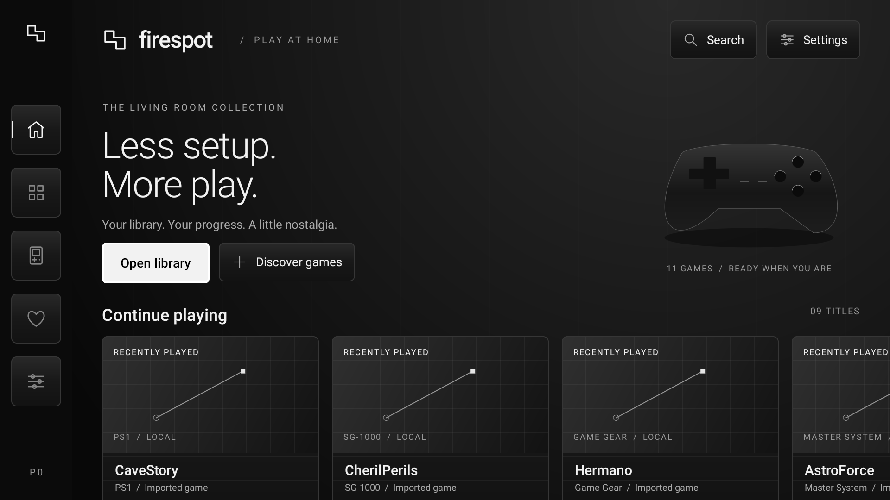
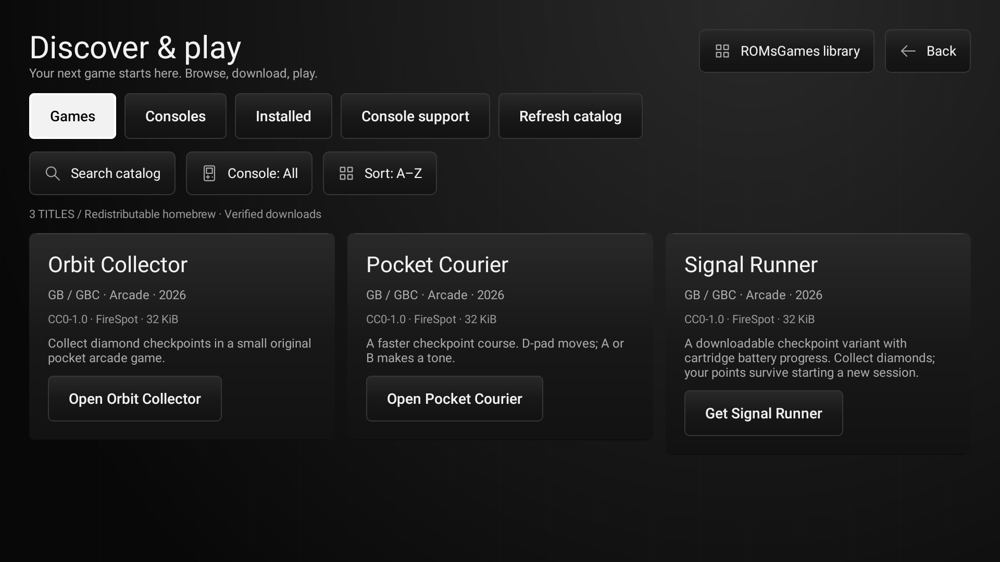
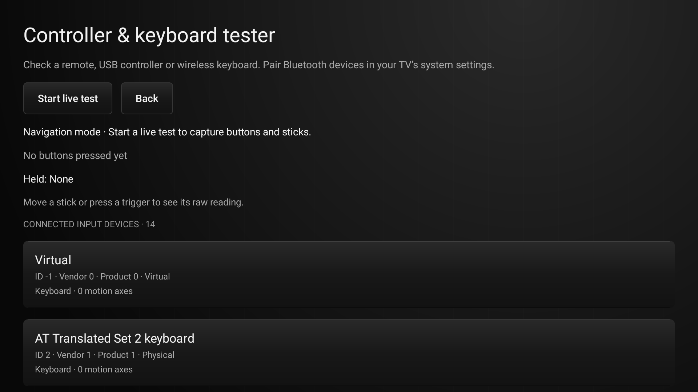
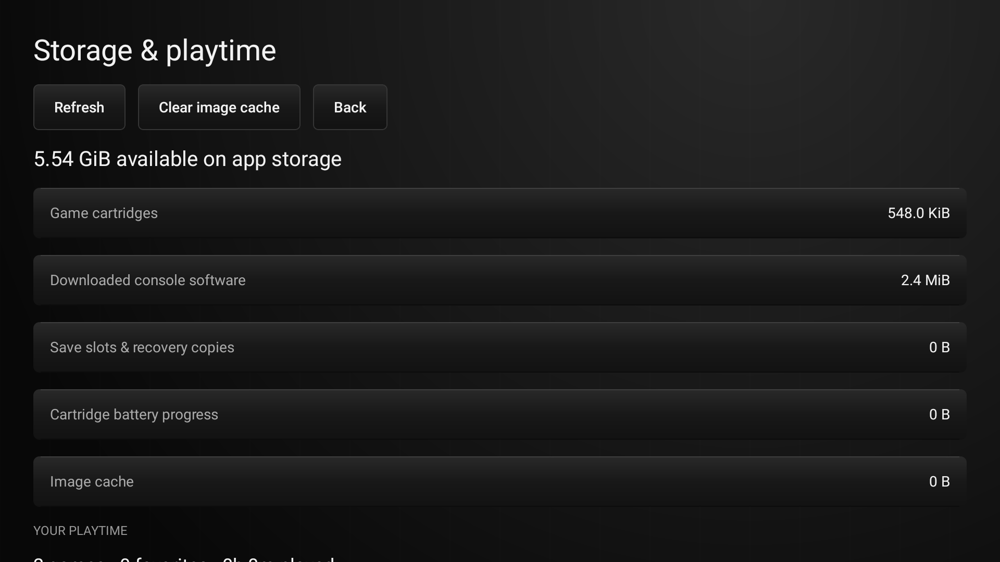

# FireSpot

**Built for Fire OS first.** FireSpot is a TV-first retro gaming app designed around Fire TV navigation, with a clean library, on-demand console support, original homebrew, game imports, and remote, controller, and keyboard input.

## Screenshots

These current app captures are from a local Android TV-profile test image.

<p align="center">
  
  
</p>
<p align="center">
  
  
</p>

## Get started

Download the latest APK from [Releases](https://github.com/Nirusaki-Malaal/firespot/releases/latest). The standard APK downloads signed console support when needed and keeps emulator cores outside the APK. A separate bundled build includes Game Boy support and two original games for offline play.

Open **Library** to play, or **Discover games** to browse original titles and the ROMsGames website. You can import supported game files from device storage. [Installation, supported formats, and controls](docs/DOCUMENTATION.md).

## Features

- **Discover:** browse console families, search the catalog, filter installed games, sort titles, and install signed console packages.
- **Library:** open the in-app ROMsGames browser, download and import supported files, and organize games with search, favorites, and filters.
- **Progress:** use four save slots, resume play, rotating autosaves, recovery copies, and cartridge battery saves.
- **Controls:** navigate with a Fire TV remote, remap buttons, play with a keyboard or gamepad, and inspect connected input with the tester.
- **Your setup:** review storage and playtime, clear the image cache safely, and configure ambient audio and interface feedback.
- **Display:** choose aspect-ratio, integer, or fill scaling and enable the optional frame counter.

FireSpot currently integrates cores for Game Boy, Game Boy Color, NES, Game Boy Advance, SNES, Master System, Game Gear, SG-1000, and PlayStation. Compatibility depends on the core, title, firmware requirements, and device. See the [console support matrix](docs/CONSOLES.md) and [validation record](docs/VALIDATION.md) for the checks completed and remaining.

## Build

JDK 17, Android SDK 34, and NDK 28.2.13676358:

```sh
./scripts/build_gameboy.sh
./gradlew :app:assembleStandardDebug
```

[Project story](docs/PROJECT_STORY.md) · [Development guide](docs/DOCUMENTATION.md) · [Library sources](docs/LIBRARY_SOURCES.md) · [CI and signed releases](docs/CI_CD.md) · [Hackathon notes](docs/HACKATHON.md)

## License

[GPL-3.0-or-later](LICENSE) for FireSpot project changes, with inherited and third-party notices preserved in [NOTICE](NOTICE). Emulator cores retain their upstream licenses; original FireSpot games are CC0. The repository is maintained independently at [Nirusaki-Malaal/firespot](https://github.com/Nirusaki-Malaal/firespot).
