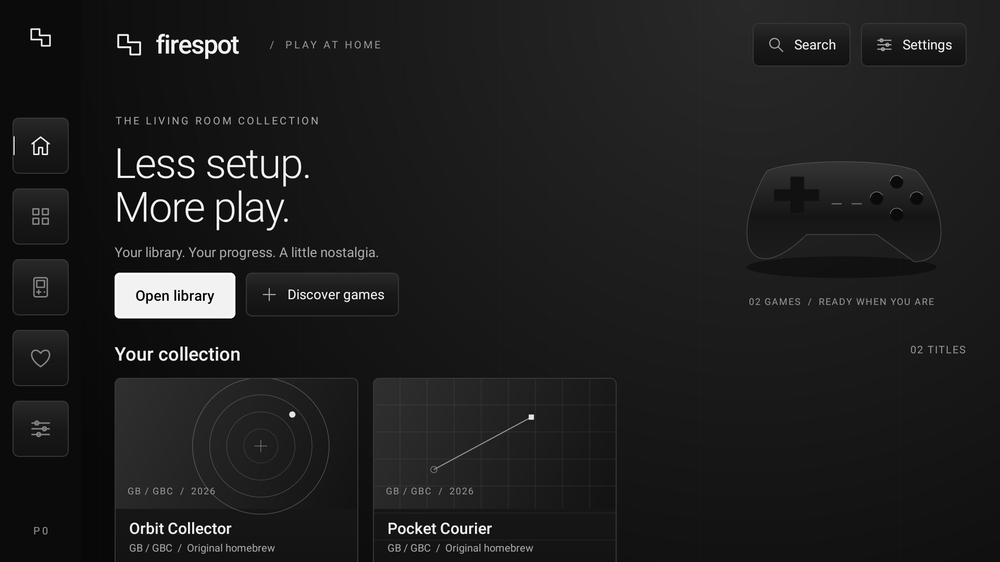
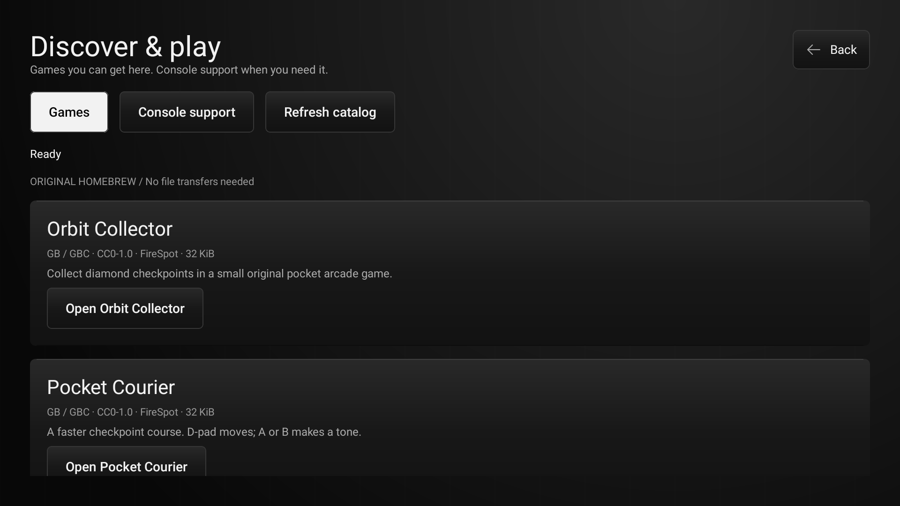
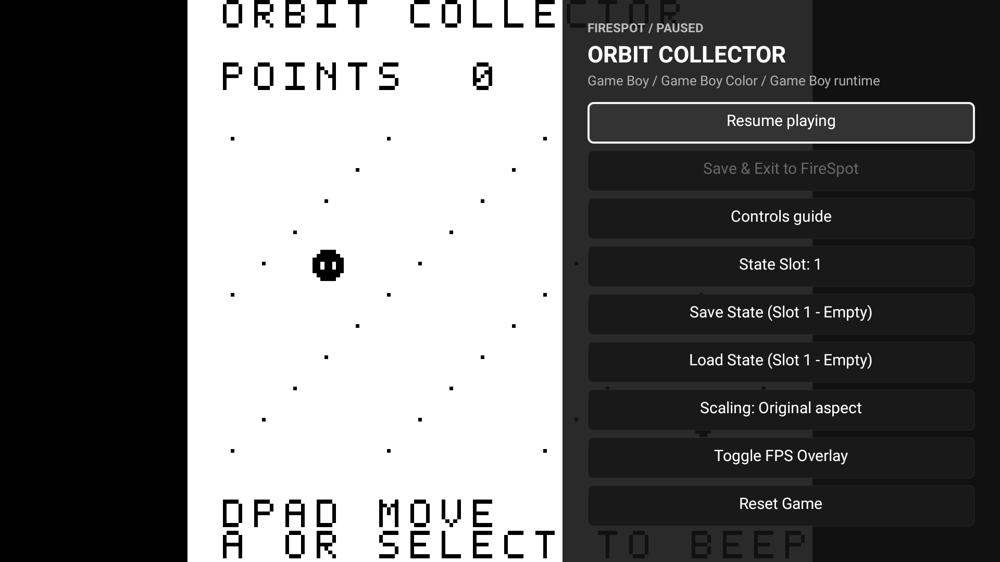

# FireSpot

**A retro gaming project by nirusaki.** A monochrome console for Fire OS with downloadable emulator support, original homebrew games, and remote, keyboard and gamepad controls.

## Screenshots

<p align="center">
  
  
  
</p>

## Install

Download an APK from [Releases](https://github.com/Nirusaki-Malaal/firespot/releases/latest).

- **Standard:** downloads console support when you first play. Keeps emulator cores outside the APK.
- **Demo:** includes Game Boy support and two original games for an immediate offline demo.

Open **Library** to play, or **Discover games** to get another original title. No account or ROM transfer is needed for the included catalog. [Installation and controls](docs/DOCUMENTATION.md).

## Features

- **Discover:** console browsing, catalog search, installed-only filtering, sorting and signed emulator packages.
- **Library:** search, favorites, recent games, console/genre filters and cartridge import.
- **Progress:** four save slots, resume, rotating autosaves, recovery and cartridge battery saves.
- **Controls:** remote navigation, gamepad remapping, keyboard play and typed search.
- **Display:** aspect ratio, integer/fill scaling, optional frame counter and restrained glass styling.

Game Boy gameplay is verified on a local Android emulator. NES, GBA, PlayStation, SNES and Sega 8-bit core packages are experimental; official Fire TV and physical wireless-device testing are pending. See the [console matrix](docs/CONSOLES.md) and [validation record](docs/VALIDATION.md).

## Build

JDK 17, Android SDK 34 and NDK 28.2.13676358:

```sh
./scripts/build_gameboy.sh
./gradlew :app:assembleStandardDebug :app:assembleDemoDebug
```

[Library and sources](docs/LIBRARY_SOURCES.md) · [Detailed development guide](docs/DOCUMENTATION.md) · [CI and signed releases](docs/CI_CD.md) · [Hackathon guide](docs/HACKATHON.md) · [Roadmap](IMPLEMENTATION_PLAN.md)

## License

[GPL-3.0-or-later](LICENSE) for FireSpot project changes, with inherited and third-party notices preserved in [NOTICE](NOTICE). Emulator cores keep their upstream licenses; original FireSpot games are CC0. Based on [shubhfront/firespot](https://github.com/shubhfront/firespot).
